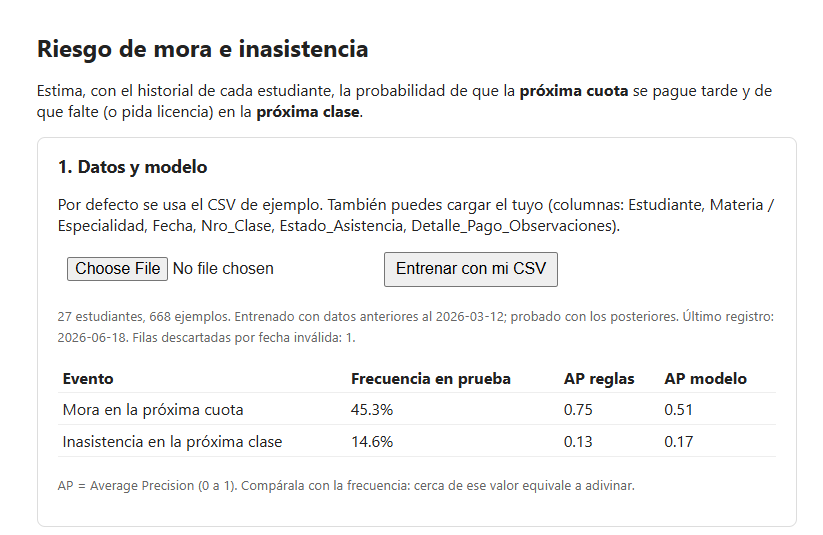
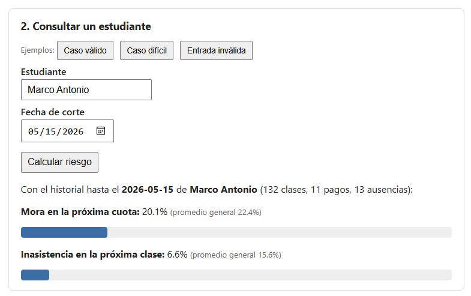
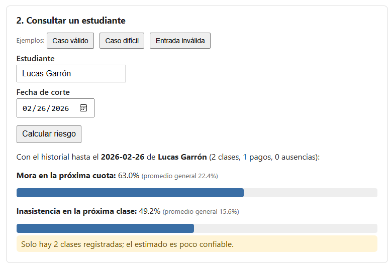
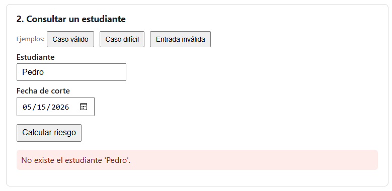

# Informe: predicción de mora e inasistencia con regresión logística

> **Autor:** Rodrigo Martín Baldiviezo Mercado  
> **Fecha:** 10/10/2026  
> **Materia:** Artificial Intelligence Capstone Project  
> **Repositorio / enlace al proyecto:** https://github.com/rbaldiviezo/mora_app

---

## 1. Problema y objetivo

Un profesor particular de música lleva un registro de clases en el que anota la asistencia de cada estudiante y los pagos de mensualidad. Con ese registro se quiere anticipar dos situaciones:

1. **Mora:** que la *próxima cuota* de un estudiante se pague tarde o no se pague.
2. **Inasistencia:** que el estudiante falte o pida licencia en la *próxima clase*.

**Objetivo general.** Construir un modelo sencillo y reproducible que, dado un estudiante y una fecha de corte, estime la probabilidad de cada evento usando solo el historial disponible hasta esa fecha.

**Objetivos específicos.**
- Preparar el registro (CSV) y convertirlo en variables por estudiante y fecha de corte.
- Entrenar una regresión logística por evento y compararla con una línea base de reglas.
- Evaluar con Average Precision, separando en el tiempo los datos de entrenamiento y de prueba.
- Exponer el modelo mediante una API y una interfaz web simple, con validación de entradas y manejo de errores.

**Unidad de observación.** Un estudiante en una fecha de corte (cada clase registrada).

---

## 2. Dataset y preparación

### 2.1 Descripción

| Aspecto | Valor |
|---|---|
| Fuente | Registro propio de clases y asistencia (archivo CSV) |
| Registros | 714 filas (una por clase o evento) |
| Estudiantes | 27 |
| Columnas | Estudiante, Materia / Especialidad, Fecha, Nro_Clase, Estado_Asistencia, Detalle_Pago_Observaciones |

Distribución de los estados de asistencia:

| Estado | Registros |
|---|---|
| Asistió / Clase realizada | 568 |
| Licencia | 96 |
| Suspendido | 23 |
| Feriado | 18 |
| Falta / No asistió | 4 |
| Otros (encuentro, ensayo, concierto, paro) | 4 |

> **Datos personales.** El archivo contiene nombres de estudiantes y montos de pago. El autor cuenta con la autorización para usar estos datos. El informe no incluye el CSV completo, solo resultados agregados y los ejemplos de prueba.

### 2.2 Limpieza

- Se convierten las fechas con formato dd/mm/aaaa; se descartó **1 fila** con fecha imposible.
- Se detectan **91 pagos** leyendo la columna de detalle (palabras como "mensualidad" o "saldo", o montos en bs; se excluye la compra de texto).
- Se extrae el número de clase desde el texto de `Nro_Clase`.
- Los días sin clase (suspendido, feriado, paro, etc.) no cuentan como clase programada ni como ausencia.

### 2.3 Cuotas (ciclos) y definición de las etiquetas

- Un **ciclo** empieza en "clase 1" y representa una cuota. Se identificaron **92 cuotas**.
- Una cuota es **mora** si el pago se registra más de 10 días después de la clase 1 o no se registra. Si el plazo aún no vence y no hay pago, se excluye por desconocida. Resultado: 23 de 92 cuotas (25%) fueron mora.
- **Inasistencia:** la próxima clase programada es "Falta" o "Licencia". Se incluyó la licencia porque solo hay 4 faltas reales.

### 2.4 Variables

Todas se calculan con el historial hasta la fecha de corte (nunca después).

| Evento | Variables |
|---|---|
| Mora | cuotas morosas previas, tasa de mora previa, pago vencido en el ciclo actual, días desde el último pago, número de pagos previos |
| Inasistencia | faltas previas, ausencias previas, tasa de ausencia previa, ausencias en las últimas 5 clases, número de clases previas |

Se generaron 668 ejemplos (estudiante y fecha de corte); 571 tienen resultado conocido para mora y 641 para inasistencia.

### 2.5 Separación entrenamiento y prueba

Separación **temporal**: el último 25% de las fechas es solo de prueba. La fecha de separación fue el **12/03/2026**. Además, se eliminan del entrenamiento las cuotas que vencen después de esa fecha, para que ningún resultado futuro se filtre.

| Evento | Ejemplos de entrenamiento | % positivos (entrenamiento) | Ejemplos de prueba | % positivos (prueba) |
|---|---|---|---|---|
| Mora | 379 | 19.3% | 106 | 45.3% |
| Inasistencia | 484 | 15.9% | 157 | 14.6% |

La mora casi se duplica entre entrenamiento y prueba, lo que indica un cambio de comportamiento (o de registro) con el tiempo.

---

## 3. Modelo y línea base

### 3.1 Modelo

**Regresión logística** (scikit-learn), una por evento. Se estandarizan las variables y se usa `class_weight="balanced"` para compensar que los casos positivos son minoría. El resultado es una probabilidad entre 0 y 1.

### 3.2 Línea base

Reglas simples que dan un puntaje de riesgo entre 0 y 1, sin aprendizaje:

- **Mora:** (2 × pago vencido en el ciclo actual + cuotas morosas previas), con tope de 5, dividido entre 5.
- **Inasistencia:** (2 × faltas previas + ausencias en las últimas 5 clases + tasa histórica de ausencia), con tope de 5, dividido entre 5.

Los pesos se eligieron por sentido común y no se ajustaron con los datos. El puntaje no es una probabilidad real; sirve para ordenar a los estudiantes por riesgo, que es lo que mide la métrica.

---

## 4. Métricas y validación

**Average Precision (AP).** Va de 0 a 1 y resume qué tan arriba de la lista de riesgo quedan los casos que realmente ocurren; mayor es mejor. Un modelo que predice al azar obtiene una AP cercana a la frecuencia del evento ([documentación de scikit-learn](https://scikit-learn.org/stable/modules/model_evaluation.html)).

**Validación.** Una sola separación temporal (entrenar con el pasado, evaluar con el futuro). No se usó validación cruzada ni ajuste de hiperparámetros.

### Tabla de resultados

| Evento | Frecuencia en prueba (azar) | AP línea base | AP regresión logística | Veces el azar (modelo) |
|---|---|---|---|---|
| Mora | 0.453 | **0.752** | 0.514 | 1.1 |
| Inasistencia | 0.146 | 0.125 | **0.166** | 1.1 |

**Lectura.**
- En **mora**, las reglas superan al modelo; este apenas mejora el azar.
- En **inasistencia**, el modelo es ligeramente mejor que las reglas, pero también apenas supera el azar.
- Con tan pocos casos positivos, estas cifras son inestables y deben tomarse como referencia, no como garantía.

---

## 5. Arquitectura e interfaz

### 5.1 Arquitectura

```
Navegador (HTML + JavaScript)  --HTTP/JSON-->  API FastAPI (app/main.py)
                                                    |
                                          app/pipeline.py
                          limpieza -> cuotas -> variables -> entrenamiento -> predicción
```

| Componente | Descripción |
|---|---|
| `app/pipeline.py` | Misma lógica del notebook (limpieza, variables, separación temporal, entrenamiento y predicción), con validación de entradas. |
| `app/main.py` | API con tres rutas: `GET /api/status`, `POST /api/train` (recibe el CSV como texto) y `POST /api/predict` (JSON con estudiante y fecha). |
| `static/index.html` | Interfaz sin frameworks, en español. |
| `tests/` | Pruebas de la lógica y de la API. |

Las predicciones se calculan en el momento con el modelo entrenado; no hay respuestas predefinidas. El modelo vive en memoria y es de un solo usuario.

**Manejo de errores:** 400 (CSV inválido o insuficiente), 404 (estudiante inexistente, con sugerencias), 413 (archivo mayor a 2 MB), 422 (fecha o nombre inválidos) y 409 (sin modelo entrenado).

### 5.2 Interfaz

La página tiene dos bloques: carga del CSV (con tabla de métricas) y consulta de un estudiante (nombre y fecha de corte), además de una sección de límites. Muestra estados de carga ("Cargando modelo...", "Calculando..."), mensajes de error y avisos de baja confianza. Incluye botones con los tres casos de prueba.

**Capturas**:

| Pantalla | Captura |
|---|---|
| Pantalla inicial con métricas |  |
| Caso válido |  |
| Caso difícil con avisos |  |
| Entrada inválida |  |

---

## 6. Pruebas realizadas

| Caso | Entrada | Resultado obtenido |
|---|---|---|
| Válido | Marco Antonio (historial largo), 15/05/2026 | Mora 20.1% e inasistencia 6.6%, sin avisos. Promedios generales: 22% y 16%. |
| Difícil | Lucas Garrón (solo 2 clases registradas), 26/02/2026 | Mora 63.0% e inasistencia 49.2%, con aviso de historial insuficiente. Valores cercanos al 50%: el modelo casi no tiene información. |
| Difícil (variante) | Omar Montellanos (9 clases, ningún pago registrado), 30/01/2026 | Mora 77.8%, con aviso de que puede reflejar falta de información. |
| Inválido | Estudiante inexistente ("Pedro") | Error 404 con mensaje claro (y sugerencias si el nombre se parece a uno real, por ejemplo "Marcos Antonio" sugiere "Marco Antonio"). |
| Inválido | Fecha `31/02/2026` o `hola` | Error 422: la fecha no es válida (formato dd/mm/aaaa). |
| Inválido | Nombre vacío | Error 422: el nombre está vacío. |
| Fecha lejana | Fecha posterior al último registro | Responde, pero avisa que no incluye lo ocurrido después. |
| Flujo completo | Subir CSV, entrenar, consultar | Las métricas reproducen las del notebook (AP 0.514 y 0.166). |

**Pruebas automáticas.**
- `tests/test_pipeline.py`: 10 pruebas de la lógica, todas aprobadas en la ejecución realizada durante el desarrollo.
- `tests/test_api.py`: pruebas a través de HTTP (caso válido, difícil, entradas inválidas, CSV incorrecto, flujo completo y página principal).

---

## 7. Conclusiones, limitaciones y referencias

### 7.1 Conclusiones

- El flujo completo funciona: del CSV a una probabilidad por evento, con validación de entradas y mensajes de error claros.
- Con estos datos, el modelo **no justifica todavía** reemplazar las reglas simples: en mora pierde contra la línea base y en inasistencia mejora muy poco.
- El valor del proyecto está en la estructura (separación temporal, línea base, avisos de confianza), que permite mejorar el modelo cuando haya más datos.

### 7.2 Limitaciones

- Pocos datos: 27 estudiantes y solo 4 faltas reales; por eso la inasistencia incluye licencias.
- La mora se deduce del texto del detalle; un pago no anotado aparece como mora. No existen fechas de vencimiento reales.
- El plazo de 10 días y los pesos de las reglas son decisiones propias, no ajustadas con los datos.
- La mora cambia mucho entre entrenamiento (19%) y prueba (45%).
- Hay errores de captura en el CSV (por ejemplo, años mal escritos) que se usan tal cual.
- Una sola separación temporal, sin validación cruzada ni ajuste de hiperparámetros.
- El modelo se guarda solo en memoria y es de un solo usuario.
- Los resultados son estimaciones y no deben usarse para decisiones sobre las personas sin revisión humana.

### 7.3 Trabajo futuro

Registrar fechas de vencimiento reales, ampliar el historial, probar otros modelos o ajustar los pesos de las reglas, y guardar el modelo en disco.

### 7.4 Referencias

1. scikit-learn. [Metrics and scoring: quantifying the quality of predictions](https://scikit-learn.org/stable/modules/model_evaluation.html).
2. scikit-learn. [average_precision_score](https://scikit-learn.org/stable/modules/generated/sklearn.metrics.average_precision_score.html).
3. scikit-learn. [Logistic regression (User Guide)](https://scikit-learn.org/stable/modules/linear_model.html#logistic-regression).
4. FastAPI. [Documentación y tutorial](https://fastapi.tiangolo.com/tutorial/).

---